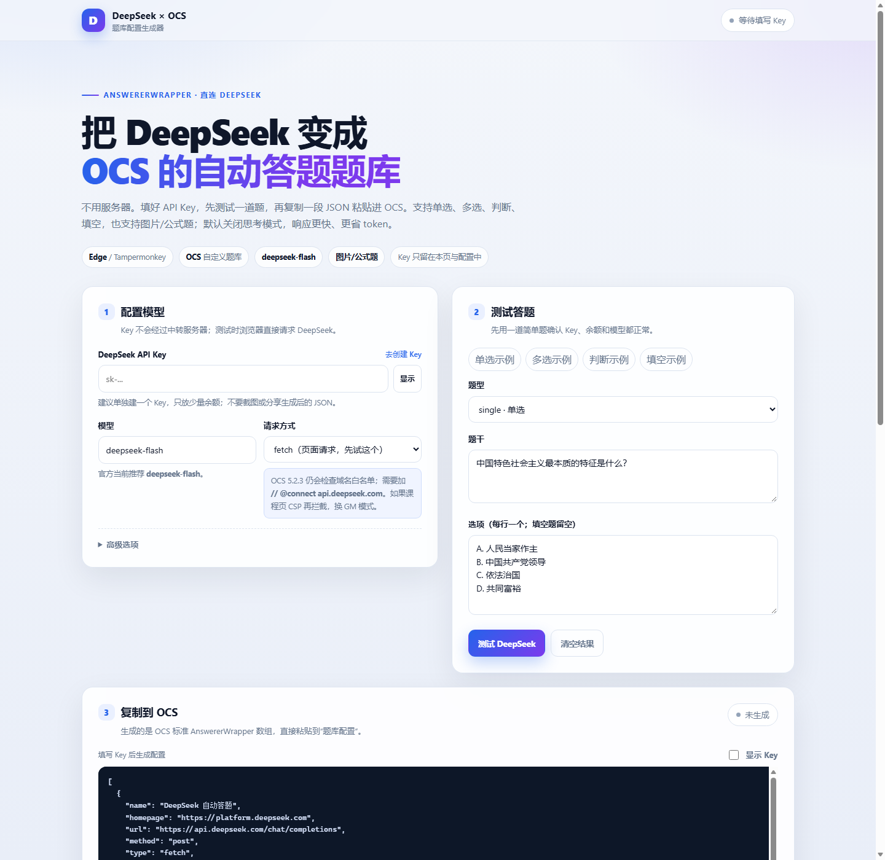

# DeepSeek × OCS 题库

把 DeepSeek 接成 OCS 的自定义题库：在 OCS 里粘贴一段 JSON，之后搜题时由 DeepSeek 直接作答。

- 适用：Windows / Edge / Tampermonkey 或脚本猫 / OCS 网课助手
- 支持：单选、多选、判断、填空，以及图片/公式题（`deepseek-flash` 视觉）
- 默认模型：`deepseek-flash`，关闭思考模式，响应更快、更省 token
- 不需要服务器，不需要安装依赖；Key 只存在本页和最终生成的 OCS 配置里

> OCS 建议使用 5.x；配置里的 `data` 字段解析器需要 OCS 4.7.21 及以上。



## 文件说明

| 文件 | 用途 |
| --- | --- |
| `index.html` | 配置生成器 + 测试页，双击打开 |
| `answerer-core.js` | 生成 OCS handler 的核心逻辑，需和 index.html 放在同一目录 |
| `ocs-deepseek-config.example.json` | 示例配置，Key 是占位符；建议用生成器生成 |
| `tests/test.html` | 离线自测页，不需要 Key |
| `tests/security-scan-test.html` | OCS 5.2.3 安全扫描兼容性测试 |
| `preview.png` | 页面截图 |
| `LICENSE` | MIT 许可证 |
| `.gitignore` | 防止把真实配置和 Key 提交到 Git |

## 快速开始

### 1. 准备 DeepSeek API Key

1. 打开 [DeepSeek 开放平台](https://platform.deepseek.com/api_keys)。
2. 创建一个 API Key，复制以 `sk-` 开头的那串字符。
3. 确认账户里有余额；API 按 token 计费，几道题通常只花很少的钱。

> 建议单独创建一个 Key，只放少量余额。不要把它发到群里或写进公开仓库。

### 2. 生成题库配置

1. 双击 `index.html`，用 Edge 打开。
2. 在“配置模型”里粘贴 API Key。
3. 点“测试 DeepSeek”，确认能返回答案。
4. 在“复制到 OCS”里点“复制题库配置”。

如果测试能通、OCS 里却连不上，把“请求方式”改成 `GM_xmlhttpRequest`，重新复制一次配置，然后看下面的“请求方式怎么选”。

### 3. 导入 OCS

1. 打开 OCS 面板 → 设置 → **题库配置**。
2. 粘贴刚才复制的完整 JSON 数组，解析器选 **默认**，保存。
3. 刷新网课页面。
4. 先把保存方式设为 **不保存也不提交**，用“在线搜题”或一道练习题验证。
5. 确认能正常选中/填入后，再开启自动保存或自动提交。

OCS 的“题库配置”要的是一个数组，形如 `[{ ... }]`。生成器复制的就是完整数组，不要只复制里面的一段。

如果你原来已经有题库，先备份，再把本配置对象追加到原数组里；不要直接拼接两个完整的 `[...]`。

## 请求方式怎么选

生成器提供两种 OCS 请求方式：

| 方式 | 优点 | 代价 |
| --- | --- | --- |
| `fetch` | 请求走页面 fetch，配置简单 | OCS 5.2.3 仍会检查域名白名单；受课程页面 CSP 限制 |
| `GM_xmlhttpRequest` | 由脚本管理器发请求，绕过页面 CSP，更稳 | 需要在 OCS 脚本头部加 `// @connect api.deepseek.com` |

建议先用 `fetch`。如果 OCS 提示“题库连接失败 / Failed to fetch”，但生成器里的测试能通，就换成 `GM_xmlhttpRequest`。

> OCS 5.2.3 起，即使选 `fetch`，保存题库配置时也可能提示“域名/ip 不在脚本的白名单中”。这不是配置错误，按下面的步骤加 `@connect` 即可，两种请求方式都建议加。

### 给 OCS 加 @connect

1. 打开 Tampermonkey（或脚本猫）管理面板。
2. 找到 OCS 网课助手 → 编辑。
3. 按 `Ctrl+Home` 回到脚本最上面，在第一组 `// ==UserScript==` 和 `// ==/UserScript==` 之间找到已有的 `// @connect` 行。
4. 在它们旁边加一行：

```javascript
// @connect      api.deepseek.com
```

5. `Ctrl+S` 保存，刷新网课页面。

如果你安装的是 OCS 的“全域名通用版本”，它自带 `// @connect *`，通常不需要再改。也可以在脚本管理器设置里把 `connect` 模式调成宽松模式（具体名称以你的脚本管理器为准）。

## 它是怎么工作的

OCS 的题库配置叫 `AnswererWrapper`。一次搜题大致是：

```text
OCS 读取题干/选项
      ↓
按配置里的 data.messages.handler 生成 DeepSeek 请求
      ↓
POST https://api.deepseek.com/chat/completions
      ↓
按配置里的 handler 解析模型返回
      ↓
返回 [题目, 答案] 给 OCS
      ↓
OCS 按题型匹配选项/填入空格
```

几个关键点：

- `model` 默认 `deepseek-flash`；它支持图片输入。`deepseek-v4-pro` 不支持视觉，图片题不要用它。
- OCS 开启“图片题优化”后会把图片放进 `env.images`，新版配置会按顺序转成 `image_url` 内容，和题干、选项一起发给模型。
- `response_format: { type: "json_object" }` 让模型输出 JSON，方便稳定解析。
- `thinking: { type: "disabled" }` 关闭思考模式，减少等待和 token。
- 提示词要求模型按 OCS 的格式输出：
  - 单选：`B`
  - 多选：`A#C`
  - 判断：`正确` / `错误`
  - 填空：多个空用 `#` 连接
- 返回给 OCS 的题目是 `undefined`，OCS 会自动显示原题；答案放在第二个位置。

## 常见问题

### OCS 5.2.3 弹“检测到题库配置中包含可疑代码 / 拼接属性访问”

这是 OCS 启发式扫描的**误报**。旧版生成器把错误提示写成 `return ['...' + msg, undefined]`，被规则当成了 `obj['a' + 'b']` 这种“拼接属性访问”；实际上它只是数组字面量，不是隐藏属性调用。

更新后的配置改成先 `const message = ...`，再 `return [message, undefined]`，不会命中该规则。重新复制一次配置并保存即可；只有确认来源可信时才点“我了解风险，仍然使用”。

### 配置成功，但提示“域名/ip 不在脚本的白名单中”

OCS 5.2.3 会检查题库 URL 的域名是否在脚本的 `@connect` 里。加一行即可：

```javascript
// @connect      api.deepseek.com
```

添加位置在 OCS 脚本最上面的第一组 `// ==UserScript==` 和 `// ==/UserScript==` 之间。保存后刷新网课页面。即使请求方式选的是 `fetch`，5.2.3 也可能做这个检查，所以两种模式都建议加。详细步骤见上面的“给 OCS 加 @connect”。

### OCS 列表显示“连接失败（401）”，但测试页能答？

这是 OCS 5.2.3 的**探测误报**。它给题库列表做状态检测时，用的是不带 `Authorization` 的 HEAD 请求：

```text
HEAD https://api.deepseek.com/chat/completions?t=...
```

DeepSeek 要求鉴权，HEAD 没带 Key 必然返回 401，于是 OCS 把状态标成“连接失败（401）”。但实际答题时，OCS 会按配置里的 headers 发 POST，请求是带 Key 的。

**判断方法**：以生成器的“测试 DeepSeek”或 OCS 实际搜题结果为准。实际搜题也返回 401，才是 Key 失效。

### 测试页能通，OCS 提示“题库连接失败”

- 确认生成器里选的请求方式；先试 `GM_xmlhttpRequest`。
- 用 GM 模式时确认已经加 `// @connect api.deepseek.com`，并保存了脚本。
- 确认 OCS 没有被其他题库配置覆盖；可以先把原有题库备份，再只保留这一条测试。
- 课程页面本身可能需要先登录、进入具体章节，OCS 才会注入。

### 401 / Authentication Fails

Key 不对、被删除，或者 `Bearer ` 后面少了空格。重新复制 Key，注意不要带引号、换行或多余空格。

### 402 / Insufficient Balance

DeepSeek 账户余额不足，去平台充值，或换一个有余额的 Key。

### 429 / Rate limit

请求太频繁。把 OCS 的搜题并发降到 1，等几十秒再试。

### 返回空内容 / 不是有效 JSON

JSON 模式偶尔会返回空内容，重新搜一次即可。仍不稳定时：

- 把 `temperature` 调到 0；
- 确认 `max_tokens` 不小于 1024；
- 如果是第三方代理，取消“发送 thinking: disabled”再试。

### 答案对，但 OCS 不选

- 先确认 OCS 识别出的题型是否正确（单选/多选/判断/填空）。
- 单选必须是一个字母；多选必须是 `A#C`；判断必须是“正确/错误”；填空多个空用 `#`。
- 太旧的 OCS 版本可能不支持这些格式，建议升级到当前版本。
- 有些平台的选项不是标准 `input`，需要 OCS 本身支持该平台；这和题库无关。

### 提示“当前题库配置暂不支持图片、公式等题目处理”

旧配置只读取题干和选项文字，没有引用 `env.images`，所以 OCS 5.2.3 会提示不支持。更新后的配置在 `messages.handler` 里读取 `env.images`、`env.suggestion_title` 和 `env.suggestion_options`，OCS 会识别为支持图片题。

处理步骤：

1. 重新从生成器复制一次题库配置并保存。
2. 在 OCS 高级设置里开启“图片题优化”。
3. 模型保持 `deepseek-flash`；`deepseek-v4-pro` 不支持视觉输入。
4. 用一道带图的练习题验证。

### 图片题 / 公式题

新版配置支持图片/公式题。OCS 5.2.3 开启“图片题优化”后，会把题目和选项里的图片转成 base64 放进 `env.images`；配置会把图片按 `[图片1]、[图片2]...` 的顺序作为 `image_url` 内容发给 `deepseek-flash`，所以公式图、截图题也能识别。

注意事项：

- 必须使用支持视觉的模型，默认的 `deepseek-flash` 可以；`deepseek-v4-pro` 不支持图片输入。
- 图片过大或过多可能超过接口限制（单张 32 MiB、请求体 48 MiB），复杂图片建议先裁剪。
- 生成器里的文本框测试只能测文字；图片题请在 OCS 实际页面验证。
- 旧配置不会自动支持图片，需要重新从生成器复制一次配置。

### AI 答案一定对吗？

不一定。模型可能理解错题意，也可能出现幻觉。建议只用来对答案、复习和自测；涉及成绩提交时先人工核对，并遵守课程平台和学校的规定。

## 安全与隐私

- API Key 会写进最终生成的 OCS 配置；OCS 配置保存在本机浏览器里。
- 生成器不会把 Key 发到 DeepSeek 以外的服务器；测试时浏览器直接请求 `api.deepseek.com`。
- 页面不会把 Key 存进 localStorage；刷新页面后需要重新输入。非敏感的模型/请求方式等设置会记住。
- 如果 Key 泄露，立即去 DeepSeek 平台删除并重建。
- OCS 题库编辑区会明文显示 Key；截图、录屏、远程协助前先遮住。
- 不要把整个浏览器配置、截图或生成的 JSON 发给别人。

## 自测

不需要 Key。直接双击 `tests/test.html` 看结果，或者在项目根目录用 Edge 无头模式运行：

```powershell
$root = (Get-Location).Path.Replace('\', '/')
& "C:\Program Files (x86)\Microsoft\Edge\Application\msedge.exe" --headless=new --disable-gpu --no-sandbox --allow-file-access-from-files --virtual-time-budget=4000 --dump-dom "file:///$root/tests/test.html"
```

看到 `RESULT: PASS` 即可。当前覆盖 73 项：提示词构造、单选/多选/判断/填空解析、图片消息构造、OCS 5.2.3 图片支持检测、代码围栏、异常返回、配置字段、handler 序列化后可独立执行等。

另有 `tests/security-scan-test.html`：按 OCS 5.2.3 的 handler 风险规则扫描生成结果，确认 `handler` 和 `data.messages.handler` 都不会触发“可疑代码”弹窗。

## 参考

- [OCS AnswererWrapper 开发文档](https://docs.ocsjs.com/docs/other/api#AnswererWrapper)
- [OCS 自动答题教程](https://docs.ocsjs.com/docs/work)
- [DeepSeek API 文档](https://api-docs.deepseek.com/)
- [DeepSeek JSON Output](https://api-docs.deepseek.com/guides/json_mode)
- [Tampermonkey @connect](https://www.tampermonkey.net/documentation.php#meta:connect)

## 说明

这是非官方工具，和 OCS、DeepSeek 都没有隶属关系。请自行确认课程平台的使用规则；因使用本工具产生的后果由使用者承担。
